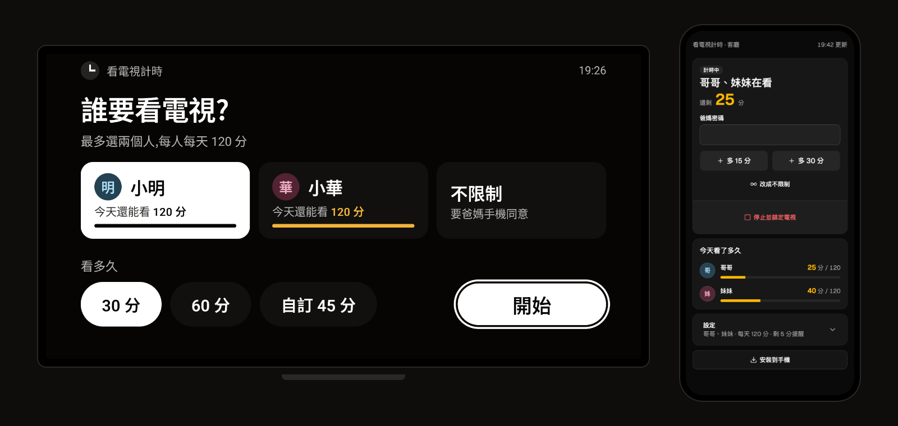
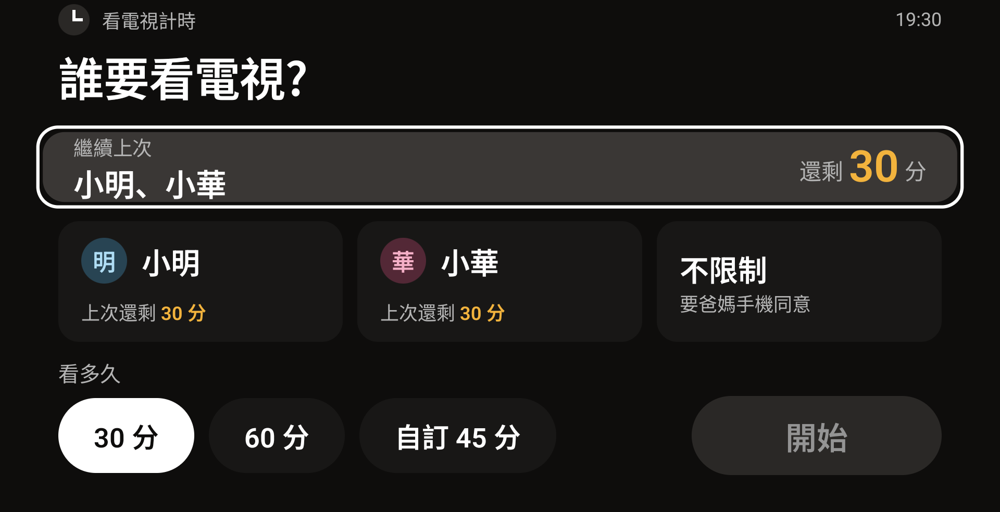
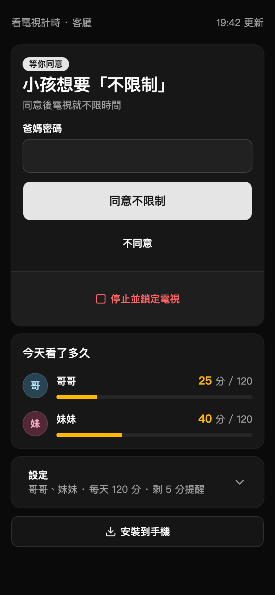
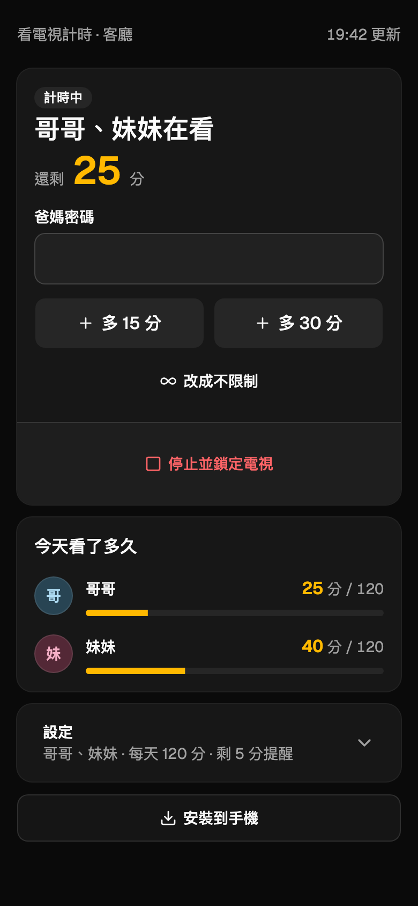

<div align="center">
  
  <h1>tv-timer</h1>
  <p><b>A screen-time lock for the family TV.</b><br>Kids pick who is watching and for how long with the remote; parents approve the rest from their phone.</p>
</div>

<p align="center">
  <a href="LICENSE"></a>
  
  
  
  <a href="#reach-it-from-anywhere-with-tailscale"></a>
</p>

<p align="center">
  English | <a href="docs/README.zh-TW.md">繁體中文</a>
</p>



> The UI is in Traditional Chinese. It runs on any Google TV / Android TV (built and tested on a Sony BRAVIA).

## Why

Screen-time controls on TVs are usually a PIN on the whole device, or a profile you have to switch to. Neither fits a living room where two kids share one TV and a parent is often in the next room.

tv-timer puts the decision on the screen itself:

- **The TV opens locked.** A kid picks who is watching (one or two people) and for how long, then presses Start.
- **The clock follows the TV, not the app.** Standby pauses the session; next time the TV turns on, "continue last time" resumes the minutes that were left.
- **Each kid has a daily allowance**, so starting a new session right after one ends does not reset the day.
- **"No limit" needs a parent.** The TV shows a QR code; the parent scans it and approves on their phone.

## Features

| | |
|---|---|
| **Lock screen** | A full-screen overlay above every app; Home and Back cannot get past it. Everything works with the D-pad |
| **Who and how long** | Up to two kids per session, quick buttons (default 30 / 60 min) and a custom duration |
| **Countdown** | A small, half-transparent "minutes left" in the corner; it turns into a large countdown in the last minutes |
| **Time's up** | Pauses whatever is playing behind it, plays a 10-second music-box chime, then locks |
| **Pause and resume** | TV standby pauses; the remaining minutes carry over. App updates do not interrupt a session |
| **Daily allowance** | Per kid, per day (default 120 min, 0 = none); a session is capped at what is left |
| **Parent phone page** | `http://TV-IP:8765/`: approve "no limit", add 15 / 30 min, stop, rename kids, change limits and PIN, test the chime |
| **Install on phone** | The parent page is a PWA: add it to the home screen and it opens full screen like an app |
| **PIN protected** | Every action needs the parent PIN; 5 wrong tries lock it for 10 minutes. The phone remembers the PIN after the first success |
| **No cloud** | Everything runs on the TV. The TV serves the parent page itself; no account, no server |

## Screenshots

| | |
|---|---|
|  |  |
| **TV after standby:** continue with the minutes left | **"No limit":** the parent scans the QR code to approve |

<p align="center">&nbsp;&nbsp;</p>
<p align="center"><b>Parent phone page:</b> approve or decline; add time while they watch</p>

> Names in the screenshots are sample data.

## How it works

| Part | What it is |
| --- | --- |
| `app/` | The Android TV app (Kotlin, Jetpack Compose). A foreground service keeps time, draws the lock overlay and runs a small HTTP server |
| `web/` | The parent phone page (React, Vite, Tailwind, shadcn/ui), built into `app/src/main/assets/web` (the build output is committed) |

API on the TV: `GET /api/state`, `POST /api/do` (JSON, needs the parent PIN).

## Install on a TV

You need a computer with `adb` and the TV on the same network.

1. On the TV: Settings → System → About → click **Android TV OS build** seven times to enable developer mode
2. Settings → System → Developer options → turn on **USB debugging**
3. On the computer:
   ```sh
   adb connect TV-IP            # tick "Always allow" on the TV, then Allow
   adb install -r app-release.apk
   adb shell appops set ai.threemi.tvtimer SYSTEM_ALERT_WINDOW allow
   adb shell am start -n ai.threemi.tvtimer/.MainActivity
   ```
4. The TV shows the parent page address and a first PIN. Open it on your phone and change the PIN and the kids' names

The overlay permission has no settings screen on most TVs, so the `appops` line is required.

## Build

```sh
# Parent phone page (only when web/ changed)
cd web && npm install && npm run build
TV=http://TV-IP:8765 npm run dev    # dev server, /api goes to the TV

# Android app (JDK 17, Android SDK)
./gradlew assembleRelease           # app/build/outputs/apk/release/app-release.apk
```

## Reach it from anywhere with Tailscale

The TV does not need Tailscale. Any always-on computer at home that runs Tailscale can forward it:

```sh
tailscale serve --bg --https=8765 http://TV-IP:8765
# on a phone in the same tailnet: https://<computer>.<tailnet>.ts.net:8765/
```

That address is HTTPS, so Android Chrome offers a real one-tap install. Turn it off with `tailscale serve --https=8765 off`.

## Limits

- A kid who opens Settings → Apps → Force stop **while a session is running** can stop it (the lock screen blocks Settings otherwise)
- A full TV restart returns to the lock screen; "no limit" does not survive a restart
- iPhone has no one-tap PWA install: use Share → Add to Home Screen

## License

[MIT](LICENSE)
